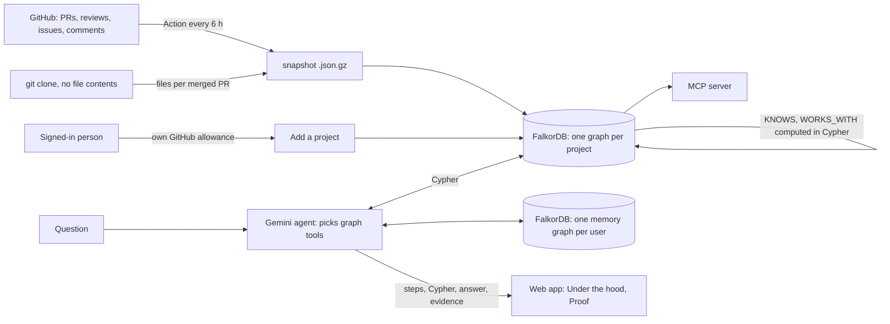
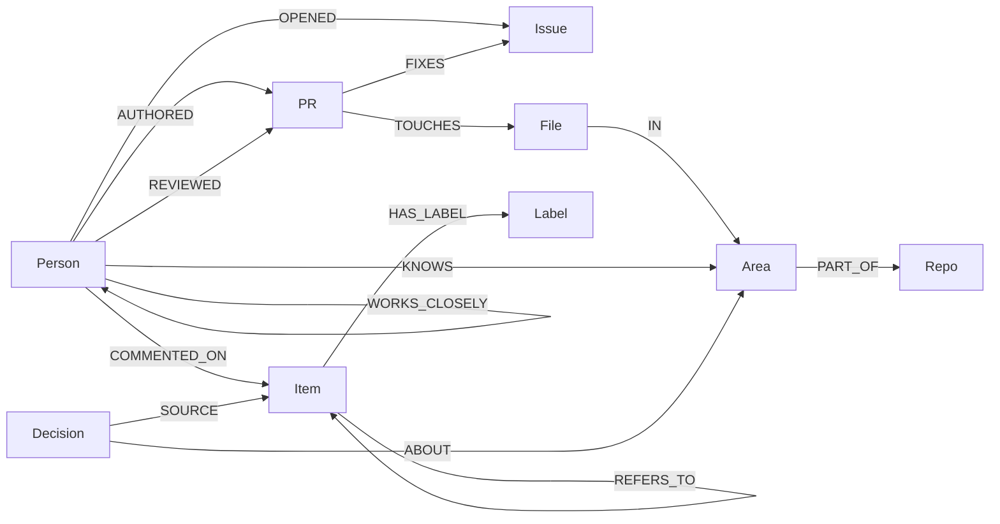

# Lore

**What an open-source project knows but never wrote down.**

Lore turns a public GitHub project's history into a graph in [FalkorDB](https://github.com/FalkorDB/FalkorDB): who wrote and reviewed which PRs, which files each one changed, which issues it fixed, who commented where. An agent then answers from that graph the questions newcomers and maintainers actually ask: who knows this part of the code, why is it built this way, has this come up before, who should look at this issue, where should I start. Every answer shows the tools it chose, the Cypher it ran, and the path through the graph behind it.

- **Live:** https://lore-gh5y.onrender.com (free plan, so the first load after a quiet spell takes up to a minute)
- **Demo video:** _link added on submission_
- **Built for:** [Graph Hacks](https://wemakedevs.org/hackathons/falkordb) (FalkorDB × WeMakeDevs), Oct 15–18, 2026
- **Tracks:** Company Brain · Agents That Act on Connected Data · Agent Memory and Coordination

## What it does

| | |
|---|---|
| **Ask** | "Who knows the query planner?" "Why does FalkorDB bound queued queries?" Answers cite a PR or issue for every claim. |
| **Triage an issue** | Pick an open issue or paste one: related past issues and PRs, the area of the code, an active person who knows it, and a drafted reply. A dry run: Lore never posts anywhere. |
| **First contribution** | Say what you know and what interests you; get what to read, a good first issue nearby, and who reviews that area. |
| **Knowledge risk** | Areas with recent work that only one active person knows well. |
| **Teams** | The teams that actually work together, found by community detection over who reviews whom; PageRank shows who holds each together. |
| **Memory** | Signed in with GitHub, Lore keeps a graph of what you asked and the areas you care about, and starts the next visit with what changed since. One click deletes it. Decisions Lore works out are saved as graph nodes linked to their sources, for everyone. |
| **Any project** | FalkorDB's own org is ready-made (six repos, refreshed every 6 hours). Signed in, paste any public org or repo and Lore builds its graph live. |
| **Under the hood, then Proof** | Each tool the agent picks and each Cypher query streams in as it runs; then the evidence graph and its sources. |
| **MCP** | The same graph tools as an MCP server, for Claude Code, Cursor or any agent. |

## Architecture



- **Data:** a scheduled GitHub Action fetches the project with GitHub's bulk API endpoints (100 items a call) and a blobless `git clone`. Squash-merged PRs end their commit subject in `(#123)`, so `git log --name-only` gives each merged PR's files without spending API calls. The Action commits a gzipped snapshot; the app loads it at startup and on each redeploy.
- **Graph:** FalkorDB, embedded with FalkorDBLite by default, or a server / FalkorDB Cloud with `FALKORDB_HOST`. Each project is its own graph; each signed-in person's memory is its own graph too.
- **Agent:** Gemini with 12 function tools, each a graph query. It may only state what tool results back, and must cite `[owner/repo#n]`. When a model is busy, retired or out of free quota, the next one takes over, and a model that just failed goes to the back of the line for a while. The model list is read from the key, never hard-coded.
- **App:** FastAPI streaming the agent's steps as server-sent events; plain HTML/JS with Cytoscape.js for the proof graph.

## Graph data model



| Node | What it is |
|---|---|
| `Person` | a GitHub login (never an email or name), with `last_active` and `active` (activity in the last 90 days) |
| `PR`, `Issue` | both also labelled `Item`, so a reference can point at either; title, state, dates, URL, the first part of the description |
| `File`, `Area` | an area is a directory: two levels deep, split further where a repo is big (any area over 6% of the repo's files splits into its subdirectories) |
| `Repo`, `Label` | in an org, a repo plays the part of a team |
| `Decision` | a reason the agent explained, saved with `SOURCE` edges to the PRs/issues it came from; never stored without one |

**Computed edges** (in Cypher, at load): `KNOWS(person, area)` with a score, `WORKS_WITH` (review ties, weighted, both ways), `WORKS_CLOSELY` (5+ reviews between two people).

**Per-user memory graph** (`user__<login>`): `(:User)-[:ASKED]->(:Question)-[:ABOUT]->(:Topic)`, `(:User)-[:INTERESTED_IN {weight}]->(:Topic)`, `(:User)-[:SEEN {at}]->(:Project)`.

## The Cypher Lore runs on

**Who knows an area** (`KNOWS`), computed inside FalkorDB. Merged PRs weigh 1.0, reviews 0.6, comments 0.2, each halving every 180 days. A PR counts once per area however many files it touched:

```cypher
MATCH (p:Person)-[:AUTHORED]->(pr:PR)-[:TOUCHES]->(:File)-[:IN]->(a:Area)
WHERE pr.merged_at IS NOT NULL
WITH DISTINCT p, pr, a, pr.merged_at AS at
WITH p, a, sum($w * exp($k * ($now - at))) AS s, count(pr) AS n, max(at) AS last
MERGE (p)-[k:KNOWS]->(a)
ON CREATE SET k.score = s, k.authored = n, k.last_at = last
ON MATCH SET k.score = k.score + s, k.authored = n
```

**Which areas an issue is about, from label history** (five hops: issue → label → other issues → the PRs that fixed them → files → areas):

```cypher
MATCH (i:Issue {id: $id})-[:HAS_LABEL]->(l:Label)<-[:HAS_LABEL]-(o:Issue)<-[:FIXES]-(pr:PR)-[:TOUCHES]->(:File)-[:IN]->(a:Area)
WHERE o <> i
WITH l, a, count(DISTINCT pr) AS n
MATCH (l)<-[:HAS_LABEL]-(:Issue)<-[:FIXES]-(all:PR)
WITH l, a, n, count(DISTINCT all) AS total
RETURN a.id AS area, a.path AS path, l.name AS label, toFloat(n) / total AS share
```

**Who should look at an issue:**

```cypher
MATCH (a:Area) WHERE a.id IN $areas
MATCH (p:Person)-[k:KNOWS]->(a)
WHERE p.active AND NOT (p)-[:OPENED]->(:Issue {id: $id})
WITH p, sum(k.score) AS score, collect(a.path) AS areas
RETURN p.login AS login, score, areas ORDER BY score DESC LIMIT $limit
```

**Related issues and PRs** (direct links up to two hops, then issues fixed in the same areas):

```cypher
MATCH (i:Issue {id: $id})-[:REFERS_TO|FIXES*1..2]-(o:Item) WHERE o <> i
RETURN DISTINCT o.id AS id, o.title AS title, o.url AS url
```

**Knowledge risk:**

```cypher
MATCH (a:Area)<-[:IN]-(:File)<-[:TOUCHES]-(pr:PR) WHERE pr.merged_at >= $since
WITH a, count(DISTINCT pr) AS recent_prs WHERE recent_prs >= $min_prs
OPTIONAL MATCH (p:Person)-[k:KNOWS]->(a) WHERE p.active AND k.score >= $min_score
WITH a, recent_prs, collect(p.login) AS knowers WHERE size(knowers) <= 1
RETURN a.path AS path, a.repo AS repo, recent_prs, knowers
```

**Graph algorithms** (built into FalkorDB):

```cypher
CALL algo.labelPropagation({nodeLabels: ['Person'], relationshipTypes: ['WORKS_CLOSELY']}) YIELD node, communityId
CALL algo.pageRank('Person', 'WORKS_WITH') YIELD node, score
CALL db.idx.fulltext.queryNodes('Item', $q) YIELD node, score    -- where a decision was discussed
```

**Memory: what changed in your areas since your last visit:**

```cypher
MATCH (a:Area) WHERE a.id IN $areas
MATCH (a)<-[:IN]-(:File)<-[:TOUCHES]-(pr:PR) WHERE pr.merged_at > $since
RETURN DISTINCT pr.id AS id, pr.title AS title, a.path AS area
```

Every query, with the reasoning behind each weight, is in [`lore/queries.py`](lore/queries.py), [`lore/load.py`](lore/load.py) and [EXPLAIN.md](EXPLAIN.md).

## Does it work?

A backtest on real history (`python -m lore backtest FalkorDB`): for 300 merged FalkorDB PRs with reviewers, Lore scores everyone **as of the day each PR was opened** (same weights, computed in the graph, so the PR's own reviews can't leak in) and we check whether its picks include a real reviewer.

| Method | Top pick is a real reviewer | A real reviewer in the top 3 |
|---|---|---|
| **Lore** | 58% | **90%** |
| The repo's most frequent reviewer so far | **61%** | 88% |
| The last people to touch the same files | 42% | 63% |

Split by time, the picture is clearer. On the newer 150 PRs, with more history behind each, Lore leads: 78% vs 71% top pick, 97% vs 97% top 3. On the older 150, with little history before them, the frequent-reviewer baseline wins the top pick, 51% vs 37%. **Lore needs history to know who knows what.** Weights tuned on the older half did no better on the newer half, so the original weights stay.

## Run it locally

```bash
git clone https://github.com/JannetEkka/lore && cd lore
python -m venv .venv && . .venv/bin/activate
pip install -r requirements.txt
python -m pytest -q                                     # 22 tests, embedded FalkorDB, no setup
export GEMINI_API_KEY=...                               # free key from aistudio.google.com
uvicorn lore.app:app --port 8000                        # http://localhost:8000, FalkorDB ready-made
```

Other commands:

```bash
export GITHUB_TOKEN=...                                 # optional: 5,000 calls an hour and approvals
python -m lore fetch owner/repo                         # or an org name
python -m lore load data/owner__repo.json
python -m lore who-knows owner/repo index --trace       # --trace prints the Cypher that ran
python -m lore backtest FalkorDB
pip install "mcp>=2" && claude mcp add lore -- python -m lore.mcp_server   # Lore's tools in Claude Code
```

| Variable | What for |
|---|---|
| `GEMINI_API_KEY` | the agent (free tier works) |
| `GITHUB_CLIENT_ID`, `GITHUB_CLIENT_SECRET` | Sign in with GitHub (an OAuth app with callback `<url>/auth/callback`) |
| `FALKORDB_HOST`, `FALKORDB_PORT`, `FALKORDB_USERNAME`, `FALKORDB_PASSWORD`, `FALKORDB_SSL` | a FalkorDB server or FalkorDB Cloud instead of the embedded one; keeps memory and added projects across restarts |

**Deploy:** `render.yaml` is a Render Blueprint (free plan, Docker). The `Dockerfile` uses Debian 13 because FalkorDBLite needs glibc 2.39. CI runs the tests, builds the image and smoke-tests it.

## Data and privacy

Public GitHub data only. Lore keeps GitHub logins, never emails or names, and skips bots. Sign-in asks GitHub for no permissions, so Lore can only read public data. Triage drafts are never posted. A person's memory is a separate graph they can delete with one click.

## Limits

- Without a token there are no approvals, only review comments. The scheduled Action uses one, so the ready-made projects have approvals.
- PRs need a `(#123)` subject or a merge commit to be tied to files; direct pushes are ignored.
- Twelve months of history by default, with caps per repo.
- Finding an issue's areas from its words is rough; the agent and the graph signals check each other.
- On a free host without `FALKORDB_HOST`, memory and added projects last until the next restart.

## Project layout

```
lore/github.py      fetch: GitHub bulk endpoints + git log → snapshot
lore/areas.py       which area a file belongs to (adaptive directory split)
lore/load.py        snapshot → graph; KNOWS, WORKS_WITH, WORKS_CLOSELY in Cypher
lore/queries.py     every question as Cypher, each recorded in a trace
lore/agent.py       Gemini tool loop with model fallback; streams each step
lore/memory.py      one memory graph per user
lore/backtest.py    would Lore have named the real reviewers?
lore/app.py         FastAPI: pages, streaming API, sign-in, add a project
lore/mcp_server.py  the graph tools over MCP
web/                landing, workspace, how it works
```

## Built with AI

Built with Claude Code as the coding assistant. Jannet Ekka chose the problem, the graph model, the scoring rule and the product design, set the requirements (sign-in, model choice, the Under the hood panel), and reviewed the code, tests and results.
